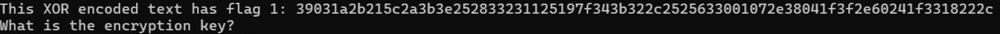
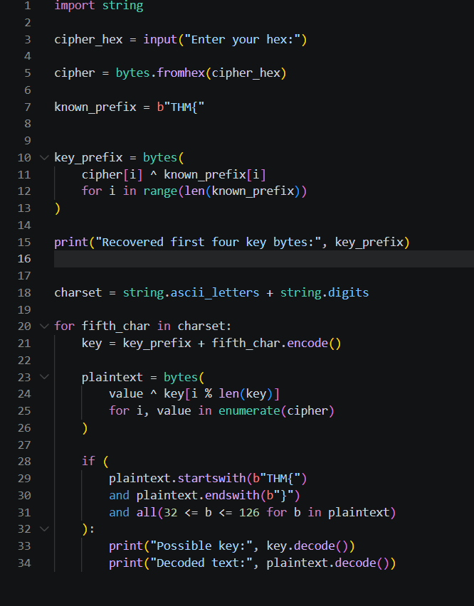
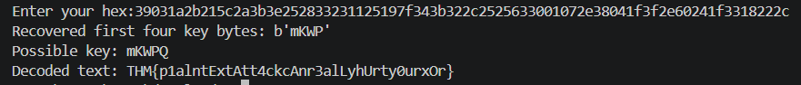
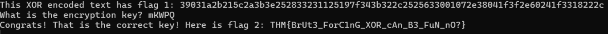

# TryHackMe - Wise Guy 

## 📌 Room Information

| Detail | Description |
|---|---|
| Platform | TryHackMe |
| Room | Wise Guy |
| Category | Cryptography |
| Technique | XOR Encryption |
| Language | Python |
| Tool Used | Custom Python Script |

## 🎯 Objective

The objective of this challenge was to investigate an encrypted message, understand how XOR encryption works, and recover the original plaintext by identifying the encryption key.

I used Python to automate the decryption process by exploiting a known plaintext prefix and brute forcing the remaining key character.

---

## 1. Initial Connection and Investigation

I started by connecting to the target machine using the information provided in the TryHackMe room.

After establishing the connection, I investigated the information provided by the challenge and identified an encrypted hexadecimal string that needed to be decrypted.

### Screenshot - Initial Connection



---

## 2. Understanding the XOR Cipher

The challenge involved XOR encryption.

XOR (Exclusive OR) is a bitwise operation that compares two bits and returns:

- `1` when the bits are different.
- `0` when the bits are the same.

One important property of XOR encryption is that applying XOR with the same key twice restores the original plaintext.

The encryption and decryption process can be represented as:

```text
Ciphertext = Plaintext XOR Key

Plaintext = Ciphertext XOR Key
```

This property makes it possible to recover the original message when the key is known.

---

## 3. Exploiting the Known Plaintext

I noticed that the decrypted message was expected to contain the prefix:

```text
THM{
```

This is useful because TryHackMe flags generally follow the `THM{...}` format.

Using this known plaintext, I could recover the corresponding first four bytes of the encryption key.

The XOR property can be used to calculate the key:

```text
Key = Ciphertext XOR Known Plaintext
```

I implemented this logic in Python.

### Screenshot - XOR Key Recovery



---

## 4. Developing the Python Decryption Script

Instead of manually trying different keys, I wrote a Python script to automate the process.

The script uses the known plaintext prefix to recover the first four key bytes and then brute-forces the fifth character.

### Python Code

```python
import string

cipher_hex = input("Enter your hex:")

cipher = bytes.fromhex(cipher_hex)

known_prefix = b"THM{"

key_prefix = bytes(
    cipher[i] ^ known_prefix[i]
    for i in range(len(known_prefix))
)

print("Recovered first four key bytes:", key_prefix)

charset = string.ascii_letters + string.digits

for fifth_char in charset:
    key = key_prefix + fifth_char.encode()

    plaintext = bytes(
        value ^ key[i % len(key)]
        for i, value in enumerate(cipher)
    )

    if (
        plaintext.startswith(b"THM{")
        and plaintext.endswith(b"}")
        and all(32 <= b <= 126 for b in plaintext)
    ):
        print("Possible key:", key.decode())
        print("Decoded text:", plaintext.decode())
```

### Understanding the Code

**Step 1 - Importing the required module**

```python
import string
```

The `string` module provides predefined character sets.

I used it to generate possible characters for the fifth key position.

**Step 2 - Taking the encrypted input**

```python
cipher_hex = input("Enter your hex:")

cipher = bytes.fromhex(cipher_hex)
```

- `input()` accepts the encrypted hexadecimal string.
- `bytes.fromhex()` converts the hexadecimal string into bytes.

**Step 3 - Defining the known plaintext**

```python
known_prefix = b"THM{"
```

I used `THM{` as the known plaintext prefix because it is the standard beginning of a TryHackMe flag.

The `b` indicates that this is a bytes object.

**Step 4 - Recovering the first four key bytes**

```python
key_prefix = bytes(
    cipher[i] ^ known_prefix[i]
    for i in range(len(known_prefix))
)
```

Since:

```text
Ciphertext = Plaintext XOR Key
```

We can rearrange it:

```text
Key = Ciphertext XOR Plaintext
```

The script XORs the first four ciphertext bytes with the known plaintext bytes to recover the first four bytes of the key.

**Step 5 - Defining the possible fifth characters**

```python
charset = string.ascii_letters + string.digits
```

This generates a character set containing:

- Lowercase letters (a-z)
- Uppercase letters (A-Z)
- Numbers (0-9)

I used this character set because the fifth character of the key was unknown.

**Step 6 - Brute-forcing the fifth character**

```python
for fifth_char in charset:
    key = key_prefix + fifth_char.encode()
```

The script iterates through every possible character in the character set.

It combines each candidate character with the four recovered key bytes to construct a possible five-character key.

**Step 7 - Decrypting the ciphertext**

```python
plaintext = bytes(
    value ^ key[i % len(key)]
    for i, value in enumerate(cipher)
)
```

This performs repeating-key XOR decryption.

- `enumerate(cipher)` provides each ciphertext byte and its index.
- `i % len(key)` ensures that the key repeats when the ciphertext is longer than the key.
- Each ciphertext byte is XORed with the corresponding key byte.

**Step 8 - Validating the decrypted output**

```python
if (
    plaintext.startswith(b"THM{")
    and plaintext.endswith(b"}")
    and all(32 <= b <= 126 for b in plaintext)
):
```

I used three conditions to identify a possible valid decryption:

- The plaintext must start with `THM{`.
- The plaintext must end with `}`.
- Every byte must be a printable ASCII character.

If all conditions are satisfied, the script displays the possible key and decrypted message.

---

## 5. Recovering the Key and Flag

After running the Python script with the encrypted hexadecimal input, the script tested the possible fifth key characters.

It identified a candidate key that produced a readable plaintext matching the expected TryHackMe flag format.

### Recovered Key and Flag







---

## 6. Key Concepts Learned

Through this challenge, I gained practical experience with:

- **XOR Encryption:** Understanding how XOR works at the bit level.
- **Known Plaintext Attack:** Using a known portion of plaintext to recover part of an encryption key.
- **Repeating-Key XOR:** Understanding how a repeating key is applied during encryption and decryption.
- **Brute Force:** Testing possible key characters to recover an unknown key.
- **Python Byte Operations:** Working with hexadecimal input, bytes, and XOR operations.
- **Automation:** Developing a Python script to automate the decryption process.

---

## 7. Conclusion

The Wise Guy room helped me understand the practical application of XOR encryption and how weaknesses in a repeating-key XOR implementation can be exploited.

Instead of manually testing possible keys, I developed a Python script that used a known plaintext prefix to recover part of the key and brute-forced the remaining character.

This challenge improved my understanding of cryptography, Python byte manipulation, known plaintext attacks, and brute-force techniques.

---


*Platform: TryHackMe | Room: Wise Guy | Category: Cryptography*
